# Spec-Driven Autonomous Agent Harness (AGENTS.md)
*Universal SDLC Protocol for AI Coding Agents, Subagents, and Human Pair Programming*

---

## 1. Executive Protocol Overview

This document defines the strict, sequential, and deterministic Software Development Life Cycle (SDLC) governing all AI coding agents operating within this repository. 

The harness enforces a **Shift-Left Quality First** philosophy: no code is written without explicit specification, adversarial interview, automated test coverage (TDD), and multi-agent audit consensus.

```mermaid
flowchart TD
    Start([Task Initiated]) --> BranchCheck{"Phase 0: Workspace Check<br/>On protected branch or new task?"}
    BranchCheck -- Yes --> CreateBranch["Create Isolated Feature Branch<br/>feat/* | fix/* | refactor/*"]
    BranchCheck -- No --> ConfigCheck
    CreateBranch --> ConfigCheck["Read harness.config.json<br/>(Locale, Stack, Adapters)"]
    
    ConfigCheck --> MentorCheck{"Mentor Mode Active?<br/>(User invoked /mentor or config)"}
    MentorCheck -- Yes --> MentorInit["Enable Pedagogical Mentoring<br/>Interactive checkpoints via ask_question"]
    MentorCheck -- No --> PlanCheck
    MentorInit --> PlanCheck
    
    PlanCheck{"Phase 1: Planning Required?<br/>User requested plan OR<br/>Structural/Database/Auth risk?"}
    
    %% Phase 1: Planning
    PlanCheck -- Yes --> GrillMe["1.A: Skill /grill-me<br/>Iterative one-by-one interview"]
    GrillMe --> WritePlan["1.B: Skill /writing-plans<br/>Draft plan in docs/plans/"]
    WritePlan --> PlanAudit["1.C: Pre-Execution Plan Audit<br/>Parallel Subagents Review"]
    PlanAudit --> UserApproval{"User Approves Plan?"}
    UserApproval -- No --> WritePlan
    UserApproval -- Yes --> Classify
    
    %% Phase 2: Execution
    PlanCheck -- No --> Classify{"Phase 2: Task Classification"}
    Classify -- "Cosmetic / Simple UI" --> AgileDev["Agile Path<br/>Direct TDD & Basic Verification"]
    Classify -- "Core / Backend / Fullstack / DB" --> RobustDev["Robust Path<br/>Strict Red-Green-Refactor TDD<br/>Full Vertical Slice & E2E"]
    
    %% Phase 2.C: Multi-Agent Audit
    RobustDev --> MultiAudit["Phase 2.C: Delegated Multi-Agent Audit<br/>Parallel review by specialized subagents"]
    AgileDev --> DocStep
    MultiAudit --> GateGreen{"Consensus GATE GREEN<br/>Unanimous approval?"}
    GateGreen -- "Findings / Risks" --> Remediation["Centralized Fixes by Primary Agent<br/>Re-verification cycle"]
    Remediation --> MultiAudit
    GateGreen -- "Approved" --> DocStep
    
    %% Phase 3 & 4: Delivery
    DocStep["Phase 3: Modular Documentation<br/>Update module README & Changelog"] --> UserCommitPrompt{"Phase 4: Ask User<br/>Commit and push to remote?"}
    UserCommitPrompt -- No --> Stop1([Halted by User])
    UserCommitPrompt -- Yes --> RunAdaptersPre["Execute Configured Adapters<br/>(Issue tracker: Jira / GitHub Issues / Linear)"]
    RunAdaptersPre --> GitCommitPush["Execute Signed/Formatted Commit & Push"]
    GitCommitPush --> StagingCheck{"Database Schema or Migrations Included?"}
    StagingCheck -- Yes --> StagingGate["Staging Migration Verification<br/>User manual validation gate"]
    StagingCheck -- No --> PRPrompt
    StagingGate --> PRPrompt{"Ask User: Open Pull Request?"}
    PRPrompt -- No --> Stop2([Halted by User])
    PRPrompt -- Yes --> OpenPR["Create Pull Request & Notify<br/>(Email / Slack / Webhook)"]
    OpenPR --> Done([Task Completed Successfully])
```

---

## 2. Configuration & Runtime Adaptation (`harness.config.json`)

Before starting any task, the agent MUST inspect the workspace configuration file `harness.config.json` (or fallback to `harness.config.example.json` if absent).

### Language & Communication Rules
- **Configuration Key:** `runtime.language` (`"en"` | `"es"`).
- If set to `"es"`, the agent MUST conduct all interactive interviews, explanations, code review reports, commit messages, and final responses in **Spanish**.
- If set to `"en"`, all communication MUST be in **English**.
- Internal prompt logic, token representations, and architectural terms remain aligned with standard engineering nomenclature.

### Pluggable Adapters
The harness isolates domain-specific tools into pluggable adapter contracts located in `.agents/adapters/`:
- **Issue Trackers:** GitHub Issues (`github-issues.md`), Jira (`jira.md`), Linear (`linear.md`), or None.
- **Database Gateways:** PostgreSQL (`postgres.md`), Supabase (`supabase.md`), Prisma (`prisma.md`), or None.
- **Delivery Notifications:** SMTP Email (`smtp-email.md`), Slack (`slack.md`), or None.

---

## 3. Specialized Subagents Registry

The harness delegates specialized verification to autonomous subagents running in parallel. Subagents provide independent, unbiased verdicts:

| Subagent | Role & Profile | Primary Verification Scope | Prompt Path |
| :--- | :--- | :--- | :--- |
| **`code-reviewer`** | *Staff Software Engineer* | Logical correctness, strict typing (zero `any`), dead code, modular boundaries, N+1 query prevention, parameter dropping across layers. | `.agents/agents/code-reviewer.md` |
| **`security-auditor`** | *Senior Cybersecurity Engineer* | STRIDE threat model, input validation / sanitization, BOLA/IDOR authorization gates, SQL/command injection, secrets exposure. | `.agents/agents/security-auditor.md` |
| **`test-engineer`** | *Senior QA / Automation Engineer* | Red-Green-Refactor compliance, edge-case coverage matrix, deterministic test execution, mock isolation vs real integration. | `.agents/agents/test-engineer.md` |
| **`database-architect`** | *Senior Database Architect* | Zero-downtime schema migrations (Expand/Contract), lock minimization, indexing strategy, query plan optimization (`EXPLAIN`). | `.agents/agents/database-architect.md` |
| **`web-performance-auditor`** | *Web Performance Engineer* | Core Web Vitals (LCP, INP, CLS), client-side bundle size, network waterfalls, excessive React re-renders, SSR/hydration boundaries. | `.agents/agents/web-performance-auditor.md` |

---

## 4. Skills Registry & Dynamic Injection

Skills are modular capability extensions stored in `.agents/skills/`. The primary agent injects relevant skills into subagents based on the task scope:

| Skill | Alias / Invocation | Purpose | Location |
| :--- | :--- | :--- | :--- |
| **Grill Me** | `/grill-me` | Interactive one-question-at-a-time interview to eliminate ambiguity before planning. | `.agents/skills/grill-me/SKILL.md` |
| **Writing Plans** | `/writing-plans` | Generates step-by-step TDD implementation plans. | `.agents/skills/writing-plans/SKILL.md` |
| **Test-Driven Development** | `/test-driven-development` | Enforces Red-Green-Refactor testing discipline before writing code. | `.agents/skills/test-driven-development/SKILL.md` |
| **Verification Before Completion** | `/verification-before-completion` | Prohibits premature completion claims without fresh, verified evidence. | `.agents/skills/verification-before-completion/SKILL.md` |
| **Software Engineering Mentor** | `/mentor` | Pedagogical mode: trains the developer through interactive checkpoints, trade-off matrices, and deep technical foundations. | `.agents/skills/software-engineering-mentor/SKILL.md` |
| **Systematic Debugging** | `/systematic-debugging` | Root-cause analysis, hypothesis testing, and regression tracing for defects. | `.agents/skills/systematic-debugging/SKILL.md` |

---

## 5. Software Engineering Mentor Mode (`/mentor`)

When activated via `/mentor`, user prompt, or configuration (`mentorMode.enabled = true`), the agent acts as an elite Staff/Principal Software Engineering Mentor:

1. **First-Principles Breakdown:** Demystifies architectural patterns (DDD, Hexagonal, Event-Driven, Concurrency models, Lock mechanisms) explaining what physically happens under the hood (memory, event loop, network, database locks).
2. **Zero Orphan Jargon:** Every technical acronym or advanced term (e.g., SSE, BZPOPMIN, IDOR, WAL, Idempotency) MUST be explained in plain language, detailing why it matters and what breaks if ignored.
3. **Trade-Off Matrix:** Every major architectural proposal MUST present discarded alternatives vs. selected design, detailing performance, maintenance, and blast-radius trade-offs.
4. **Interactive Checkpoints (`ask_question`):** Formulates interactive multiple-choice questions or architectural dilemmas to confirm the apprentice's comprehension before progressing to implementation.
5. **Append-Only Learning Log:** Updates `docs/mentor/apprentice-progress.md` with accumulated XP, completed milestones, and key technical takeaways without ever truncating previous entries.

---

## 6. Phase 0: Workspace Isolation & Branch Lock

Before creating, editing, or deleting any file:
1. **Branch Verification:** Check the current active branch via `git branch --show-current`.
2. **Protected Branch Lock:** Direct modification of protected branches (`main`, `master`, `production`) is **strictly prohibited**.
3. **Dedicated Branch Creation:**
   - Always branch off an updated base branch (`git checkout main && git pull`).
   - Create a clean, dedicated feature branch: `git checkout -b <type>/<slug>` (e.g., `feat/auth-sso`, `fix/cache-stampede`, `refactor/order-pipeline`).
4. **Deterministic Git Hooks:** Ensure local git hooks (`scripts/git-hooks/pre-commit`, `pre-push`) are active to prevent accidental direct pushes, secret leaks, or untyped code merges.

---

## 7. Phase 1: Interactive Discovery & Shift-Left Planning

### Activation Triggers
Phase 1 triggers automatically whenever:
- The user requests a plan or complex architecture.
- Structural database schemas, migrations, or DDL changes are required.
- Authentication, authorization (RBAC/RLS), or security boundaries are altered.
- Changes impact multiple decoupled architectural modules.

### 1.A. Skill `/grill-me` (Iterative Clarification)
- Inspect existing codebase thoroughly before asking questions.
- Ask **exactly one question at a time** using `ask_question`.
- Include an educated hypothesis (`GUESS`) with each question to accelerate alignment.
- Await user response before proceeding. Conclude with a clear restatement summary.

### 1.B. Skill `/writing-plans` (Structured Blueprint)
Create the implementation plan in `docs/plans/YYYY-MM-DD-<feature-slug>.md` with:
- **Architecture Context & Trade-Offs**: Discarded vs chosen approach.
- **Step-by-Step TDD Tasks**: For every task, define (1) Failing Test, (2) Minimal Implementation, (3) Verification Command.
- **Vertical Slice Contract**: Prohibit parameter dropping across controllers, services, repositories, and entities.

### 1.C. Delegated Plan Audit
Dispatch specialized subagents in parallel (`code-reviewer`, `security-auditor`, `database-architect`, etc.) to review the drafted plan for edge cases, security vulnerabilities, and scalability bottlenecks **before** asking for final user approval.

---

## 8. Phase 2: Execution & Quality Assurance

### 2.A. Classification of Scope
- **Agile Path (Cosmetic / Low Risk):** Isolated styling, typography, minor text/button updates. Requires adapted unit test and direct verification.
- **Robust Path (Core / Backend / Fullstack / High Risk):** Full TDD cycle, vertical slice integration tests, and end-to-end verification.

### 2.B. Strict Red-Green-Refactor TDD
1. **Red:** Write a focused test reproducing the required behavior or defect. Run the test and confirm it fails for the expected reason.
2. **Green:** Write the minimal production code necessary to make the test pass.
3. **Refactor:** Clean code, optimize types, and eliminate duplication while maintaining 100% green tests.

### 2.C. Phase 2.C: Multi-Agent Parallel Audit Matrix
Before declaring any task complete, dispatch subagents simultaneously according to affected layers:

| Change Scope | Subagents Dispatched in Parallel |
| :--- | :--- |
| **Backend / API / Core Logic** | `code-reviewer` + `security-auditor` + `test-engineer` |
| **Database / Persistence / Migrations** | `code-reviewer` + `security-auditor` + `test-engineer` + `database-architect` |
| **Frontend / Web UI** | `code-reviewer` + `security-auditor` + `test-engineer` + `web-performance-auditor` |
| **Fullstack System** | `code-reviewer` + `security-auditor` + `test-engineer` + `database-architect` + `web-performance-auditor` |

**GATE GREEN Rule:** Integration is blocked until ALL dispatched subagents issue an explicit `APPROVE` verdict with zero unresolved Critical or High findings.

---

## 9. Phase 3: Modular Documentation

Every functional update MUST update documentation as code:
1. Locate or create the `README.md` for the modified module/package.
2. Document architectural additions, API contracts, environment requirements, and timestamp of modification.
3. Keep project-level documentation synchronized.

---

## 10. Phase 4: Delivery, Deployment & Notification Pipeline

Follow this deterministic sequence:
1. **User Confirmation for Commit/Push:** Explicitly prompt the user before staging and pushing.
2. **Issue Tracker Adapter:** If configured, update ticket/issue status (GitHub Issues, Jira, Linear) to Completed or Ready for Review.
3. **Git Commit & Push:** Commit using standard Conventional Commits format (`feat(...)`, `fix(...)`, `refactor(...)`).
4. **Staging Database Migration Gate (if applicable):** If migrations are included, pause for user verification in the staging environment before any production rollout.
5. **Pull Request Gate:** Prompt the user to confirm opening a Pull Request to the default branch.
6. **Notification Adapter:** If configured, dispatch executive notification summary via Email or Slack.
