# Spec-Driven Agent Harness 🛡️🤖
*Arnés Determinista y SDLC Shift-Left para Agentes de Código de IA y Pair Programming Humano-IA.*

[](LICENSE)
[](AGENTS.md)
[](#m%C3%A1quina-de-estados-del-ciclo-de-vida)
[](#subagentes-especializados)
[](README.md)

---

## 💡 ¿Qué es `spec-driven-agent-harness`?

La mayoría de los asistentes de código con IA sufren de **deriva de contexto (context drift)**, **falta de límites de seguridad (guardrails)** y **programación prematura** (generar bloques masivos de código sin probar que rompen producción).

`spec-driven-agent-harness` resuelve este problema introduciendo un **motor de ciclo de vida determinista** orquestado mediante [`AGENTS.md`](AGENTS.md). Transforma agentes LLM estándar (Antigravity, Cursor, Claude Code, Cline, Windsurf) en ingenieros de software disciplinados bajo la filosofía **Shift-Left Quality First**:

1. **🔒 Aislamiento de Rama y Candado Git:** Bloquea físicamente commits o pushes directos a ramas protegidas (`main`, `master`).
2. **🎯 Clarificación Interactiva (`/grill-me`):** Cuestiona suposiciones una por una con hipótesis antes de redactar arquitectura.
3. **📋 Planes TDD Estructurados (`/writing-plans`):** Exige ciclos Red-Green-Refactor y contratos de rebanada vertical completa (prohibiendo la pérdida de parámetros entre capas).
4. **👥 Multi-Auditoría Delegada con Subagentes:** Ejecuta subagentes en paralelo (`code-reviewer`, `security-auditor`, `test-engineer`, `database-architect`, `web-performance-auditor`) con requisito unánime de `GATE GREEN`.
5. **🎓 Modo Mentor Integrado (`/mentor`):** Convierte las sesiones en aprendizajes técnicos de nivel Staff Engineer con explicaciones desde primeros principios y checkpoints interactivos con `ask_question`.
6. **🔌 Adaptadores Modulares:** Conexión desacoplada con gestores de tareas (GitHub Issues, Jira, Linear), bases de datos (PostgreSQL, Supabase, Prisma) y notificaciones.

---

## 🔄 Máquina de Estados del Ciclo de Vida

```mermaid
flowchart TD
    Start([Inicio de la Tarea]) --> BranchCheck{"Fase 0: ¿Modifica archivos y está en rama protegida<br/>o es una nueva funcionalidad?"}
    BranchCheck -- Sí --> CreateBranch["Crear rama aislada limpia<br/>feat/* | fix/* | refactor/*"]
    BranchCheck -- No --> ConfigCheck
    CreateBranch --> ConfigCheck["Leer harness.config.json<br/>(Idioma, Stack, Adaptadores)"]
    
    ConfigCheck --> MentorCheck{"¿Modo Mentor Activo?<br/>(vía /mentor o configuración)"}
    MentorCheck -- Sí --> MentorInit["Activar Mentoría Pedagógica<br/>Checkpoints interactivos con ask_question"]
    MentorCheck -- No --> PlanCheck
    MentorInit --> PlanCheck
    
    PlanCheck{"Fase 1: ¿Requiere Planificación?<br/>¿Solicitado por usuario O<br/>Riesgo en BD/Auth/Estructural?"}
    
    PlanCheck -- Sí --> GrillMe["1.A: Skill /grill-me<br/>Entrevista individual con ask_question"]
    GrillMe --> WritePlan["1.B: Skill /writing-plans<br/>Redactar plan en docs/plans/"]
    WritePlan --> PlanAudit["1.C: Auditoría Previa del Plan<br/>Revisión en paralelo por subagentes"]
    PlanAudit --> UserApproval{"¿Usuario aprueba el plan?"}
    UserApproval -- No --> WritePlan
    UserApproval -- Sí --> Classify
    
    PlanCheck -- No --> Classify{"Fase 2: Clasificación de Complejidad"}
    Classify -- "Cosmético / UI Simple" --> AgileDev["Ruta Ágil<br/>TDD puntual y verificación directa"]
    Classify -- "Core / Backend / Fullstack / BD" --> RobustDev["Ruta Robusta<br/>TDD estricto Red-Green-Refactor<br/>Rebanada vertical completa y E2E"]
    
    RobustDev --> MultiAudit["Fase 2.C: Multi-Auditoría Delegada<br/>Revisión en paralelo por subagentes"]
    AgileDev --> DocStep
    MultiAudit --> GateGreen{"Consenso GATE GREEN<br/>¿Aprobación unánime?"}
    GateGreen -- "Hallazgos / Riesgos" --> Remediation["Correcciones del Agente Principal<br/>Ciclo de re-verificación"]
    Remediation --> MultiAudit
    GateGreen -- "Aprobado 100%" --> DocStep
    
    DocStep["Fase 3: Documentación Modular<br/>Actualizar README del módulo y Changelog"] --> UserCommitPrompt{"Fase 4: Preguntar al Usuario:<br/>¿Commit y push a rama remota?"}
    UserCommitPrompt -- No --> Stop1([Detenido por Usuario])
    UserCommitPrompt -- Yes --> RunAdaptersPre["Ejecutar Adaptadores Configurados<br/>(Jira / GitHub Issues / Linear)"]
    RunAdaptersPre --> GitCommitPush["Ejecutar Commit Formateado y Push"]
    GitCommitPush --> StagingCheck{"¿Incluye Migraciones de BD?"}
    StagingCheck -- Yes --> StagingGate["Validación en Entorno Staging<br/>Compuerta manual del usuario"]
    StagingCheck -- No --> PRPrompt
    StagingGate --> PRPrompt{"Preguntar al Usuario:<br/>¿Crear Pull Request?"}
    PRPrompt -- No --> Stop2([Detenido por Usuario])
    PRPrompt -- Yes --> OpenPR["Crear Pull Request y Notificar<br/>(Email / Slack / Webhook)"]
    OpenPR --> Done([Tarea Finalizada con Éxito])
```



---

## 👥 Subagentes Especializados

El arnés incluye las definiciones listas para usar en `.agents/agents/`:

| Subagente | Rol | Foco de Inspección |
| :--- | :--- | :--- |
| **`code-reviewer`** | *Staff Engineer* | Corrección lógica, tipado estricto (cero `any`), modularidad, prevención de fuga de parámetros. |
| **`security-auditor`** | *Cybersecurity Engineer* | Modelo de amenazas STRIDE, mitigación BOLA/IDOR, sanitización de entradas, cero secretos. |
| **`test-engineer`** | *Senior QA Automation* | Verificación Red-Green-Refactor, cobertura de casos límite, pruebas deterministas. |
| **`database-architect`** | *Database Architect* | Migraciones con cero downtime (Expand/Contract), minimización de locks, indexación. |
| **`web-performance-auditor`** | *Web Performance Engineer* | Core Web Vitals (LCP, INP, CLS), presupuesto de bundles, cascadas de red. |
| **`backend-architect`** | *Principal Architect* | Diseño Guiado por el Dominio (DDD), arquitectura hexagonal, contratos de API estables. |
| **`frontend-developer`** | *Staff Frontend Engineer* | Accesibilidad web (WCAG 2.2 AA), diseño de componentes atómicos, estado mínimo. |

---

## 🚀 Inicio Rápido e Instalación

### Opción 1: Usar como Plantilla de GitHub
Haz clic en **"Use this template"** en GitHub para iniciar un nuevo proyecto con el arnés preconfigurado.

### Opción 2: Instalar en un Proyecto Existente

#### En Windows (PowerShell):
```powershell
# Clona o descarga este repositorio y ejecuta:
./scripts/init-harness.ps1 -TargetDirectory "C:/ruta/a/tu/proyecto"
```

#### En Linux / macOS (Bash):
```bash
./scripts/init-harness.sh /ruta/a/tu/proyecto
```

### Opción 3: Configurar tu Proyecto
Copia y personaliza `harness.config.example.json` como `harness.config.json`:
```json
{
  "project": {
    "name": "MiProyecto",
    "defaultBranch": "main"
  },
  "runtime": {
    "language": "es" // 'es' para interacción en español, 'en' para inglés
  },
  "mentorMode": {
    "enabled": true
  },
  "adapters": {
    "issueTracker": { "provider": "github-issues" },
    "database": { "provider": "postgres" },
    "notifications": { "provider": "none" }
  }
}
```

---

## 🌐 Arquitectura Bilingüe

Este proyecto fue diseñado con soporte bilingüe nativo:
- **Motor de Razonamiento en Inglés:** Los protocolos maestros y prompts de subagentes utilizan tokens en inglés para máxima precisión técnica y ahorro de contexto.
- **Interacción en Español:** Con solo configurar `"language": "es"`, el agente mantendrá todas las conversaciones, explicaciones del modo mentor, preguntas interactivas y reportes en perfecto español.

---

## 📄 Licencia
Licencia MIT. Libre para uso, modificación y distribución en proyectos personales o comerciales.
