# Spec-Driven Agent Harness 🛡️🤖
*Deterministic, Shift-Left SDLC Harness for AI Coding Agents and Human-AI Pair Programming.*

[](LICENSE)
[](AGENTS.md)
[](#lifecycle-state-machine)
[](#specialized-subagents)
[](README.es.md)

---

## 💡 What is `spec-driven-agent-harness`?

Most AI coding assistants suffer from **context drift**, **lack of guardrails**, and **premature coding** (generating large blocks of untested code that break production).

`spec-driven-agent-harness` solves this by introducing a **deterministic lifecycle engine** configured via [`AGENTS.md`](AGENTS.md). It transforms raw LLM agents (Antigravity, Cursor, Claude Code, Cline, Windsurf) into disciplined engineering peers that follow strict **Shift-Left Quality First** principles:

1. **🔒 Branch Isolation & Git Lock:** Physically blocks direct commits and pushes to protected branches (`main`, `master`).
2. **🎯 Adversarial Clarification (`/grill-me`):** Questions assumptions one-by-one before drafting architecture.
3. **📋 Spec & TDD Plans (`/writing-plans`):** Enforces Red-Green-Refactor cycles and full vertical slice contracts (prohibiting parameter dropping).
4. **👥 Delegated Multi-Agent Audit:** Runs parallel subagents (`code-reviewer`, `security-auditor`, `test-engineer`, `database-architect`, `web-performance-auditor`) with mandatory unanimous `GATE GREEN` consensus.
5. **🎓 Built-In Mentor Mode (`/mentor`):** Transforms sessions into interactive apprenticeships with first-principles explanations and interactive dilemmas (`ask_question`).
6. **🔌 Pluggable Adapters:** Extensible slots for Issue Trackers (GitHub Issues, Jira, Linear), Databases (PostgreSQL, Supabase, Prisma), and Notifications.

---

## 🔄 Lifecycle State Machine

```mermaid
flowchart TD
    Start([Task Initiated]) --> BranchCheck{"Phase 0: Workspace Check<br/>Protected branch or new task?"}
    BranchCheck -- Yes --> CreateBranch["Create Isolated Feature Branch<br/>feat/* | fix/* | refactor/*"]
    BranchCheck -- No --> ConfigCheck
    CreateBranch --> ConfigCheck["Read harness.config.json<br/>(Locale, Stack, Adapters)"]
    
    ConfigCheck --> MentorCheck{"Mentor Mode Active?<br/>(/mentor or config)"}
    MentorCheck -- Yes --> MentorInit["Enable Pedagogical Mentoring<br/>Interactive checkpoints via ask_question"]
    MentorCheck -- No --> PlanCheck
    MentorInit --> PlanCheck
    
    PlanCheck{"Phase 1: Planning Required?<br/>Plan requested OR<br/>Structural/DB/Auth risk?"}
    
    PlanCheck -- Yes --> GrillMe["1.A: Skill /grill-me<br/>Iterative one-by-one interview"]
    GrillMe --> WritePlan["1.B: Skill /writing-plans<br/>Draft plan in docs/plans/"]
    WritePlan --> PlanAudit["1.C: Pre-Execution Plan Audit<br/>Parallel Subagents Review"]
    PlanAudit --> UserApproval{"User Approves Plan?"}
    UserApproval -- No --> WritePlan
    UserApproval -- Yes --> Classify
    
    PlanCheck -- No --> Classify{"Phase 2: Task Classification"}
    Classify -- "Cosmetic / Simple UI" --> AgileDev["Agile Path<br/>Direct TDD & Basic Verification"]
    Classify -- "Core / Backend / Fullstack / DB" --> RobustDev["Robust Path<br/>Strict Red-Green-Refactor TDD<br/>Full Vertical Slice & E2E"]
    
    RobustDev --> MultiAudit["Phase 2.C: Multi-Agent Audit<br/>Parallel review by specialized subagents"]
    AgileDev --> DocStep
    MultiAudit --> GateGreen{"Consensus GATE GREEN<br/>Unanimous approval?"}
    GateGreen -- "Findings / Risks" --> Remediation["Fixes by Primary Agent<br/>Re-verification cycle"]
    Remediation --> MultiAudit
    GateGreen -- "Approved" --> DocStep
    
    DocStep["Phase 3: Modular Documentation<br/>Update module README & Changelog"] --> UserCommitPrompt{"Phase 4: Ask User<br/>Commit & push to remote?"}
    UserCommitPrompt -- No --> Stop1([Halted by User])
    UserCommitPrompt -- Yes --> RunAdaptersPre["Execute Configured Adapters<br/>(Jira / GitHub Issues / Linear)"]
    RunAdaptersPre --> GitCommitPush["Execute Signed/Formatted Commit & Push"]
    GitCommitPush --> StagingCheck{"Database Migrations Included?"}
    StagingCheck -- Yes --> StagingGate["Staging Migration Verification<br/>User manual validation gate"]
    StagingCheck -- No --> PRPrompt
    StagingGate --> PRPrompt{"Ask User: Open Pull Request?"}
    PRPrompt -- No --> Stop2([Halted by User])
    PRPrompt -- Yes --> OpenPR["Create Pull Request & Notify<br/>(Email / Slack / Webhook)"]
    OpenPR --> Done([Task Completed Successfully])
```



---

## 👥 Specialized Subagents

The harness includes standalone, battle-tested subagent definitions in `.agents/agents/`:

| Subagent | Role | Focus |
| :--- | :--- | :--- |
| **`code-reviewer`** | *Staff Engineer* | Logical correctness, strict typing (zero `any`), KISS/YAGNI, anti-parameter dropping. |
| **`security-auditor`** | *Cybersecurity Engineer* | STRIDE threat modeling, BOLA/IDOR prevention, input sanitization, zero secrets. |
| **`test-engineer`** | *Senior QA Automation* | Red-Green-Refactor verification, edge case coverage, deterministic test runs. |
| **`database-architect`** | *Database Architect* | Zero-downtime migrations (Expand/Contract), lock minimization, indexing strategy. |
| **`web-performance-auditor`** | *Web Performance Engineer* | Core Web Vitals (LCP, INP, CLS), bundle size budgets, render cascade prevention. |
| **`backend-architect`** | *Principal Architect* | Domain-driven design (DDD), hexagonal architectures, resilient API contracts. |
| **`frontend-developer`** | *Staff Frontend Engineer* | Accessible UI (WCAG 2.2 AA), component design, state minimization. |

---

## 🚀 Quick Start & Installation

### Option 1: Use as a GitHub Template
Click **"Use this template"** on GitHub to start a brand-new project with the harness pre-installed.

### Option 2: Install into an Existing Project

#### On Windows (PowerShell):
```powershell
# Clone or download this repository, then run:
./scripts/init-harness.ps1 -TargetDirectory "C:/path/to/your/project"
```

#### On Linux / macOS (Bash):
```bash
./scripts/init-harness.sh /path/to/your/project
```

### Option 3: Configure Your Project
Copy and customize `harness.config.example.json` as `harness.config.json`:
```json
{
  "project": {
    "name": "MyCoolApp",
    "defaultBranch": "main"
  },
  "runtime": {
    "language": "es" // Set to "es" for Spanish interaction, or "en" for English
  },
  "mentorMode": {
    "enabled": true
  },
  "adapters": {
    "issueTracker": { "provider": "github-issues" },
    "database": { "provider": "postgres" },
    "notifications": { "provider": "none" }
  }
}
```

---

## 📂 Repository Structure

```text
spec-driven-agent-harness/
├── AGENTS.md                          # Master Autonomous SDLC Protocol
├── harness.config.example.json        # Project runtime & adapter configuration
├── README.md                          # English documentation
├── README.es.md                       # Spanish documentation
├── .agents/
│   ├── agents/                        # Subagent prompts
│   ├── skills/                        # Core methodology skills
│   └── adapters/                      # Pluggable integrations (issues, db, alerts)
├── docs/
│   └── templates/                     # Plans & mentor log templates
└── scripts/
    ├── git-hooks/                     # Deterministic pre-commit and pre-push hooks
    ├── install-hooks.ps1              # Hook installer (Windows)
    ├── install-hooks.sh               # Hook installer (Unix)
    ├── init-harness.ps1               # Bootstrapper (Windows)
    └── init-harness.sh                # Bootstrapper (Unix)
```

---

## 🌐 Bilingual Support / Soporte Bilingüe

This framework was built from the ground up with a bilingual architecture:
- **Core Reasoning Engine in English:** Protocols and subagent prompts leverage compact, high-precision English tokens.
- **Localized Interaction in Spanish or English:** Configure `"language": "es"` in `harness.config.json`, and the agent will conduct 100% of its user conversations, explanations, reviews, and questions in Spanish!
- Consulta la documentación completa en español en [`README.es.md`](README.es.md).

---

## 📄 License
MIT License. Free to use, modify, and distribute in personal and commercial projects.
